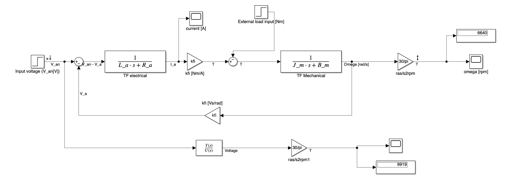
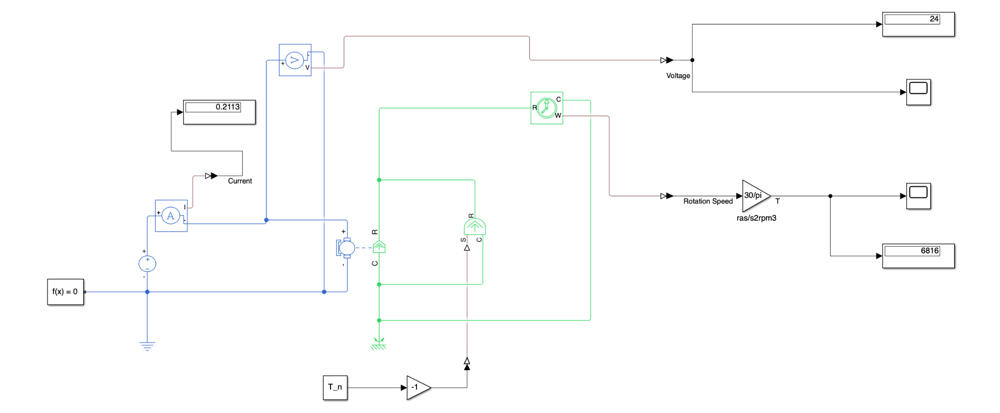
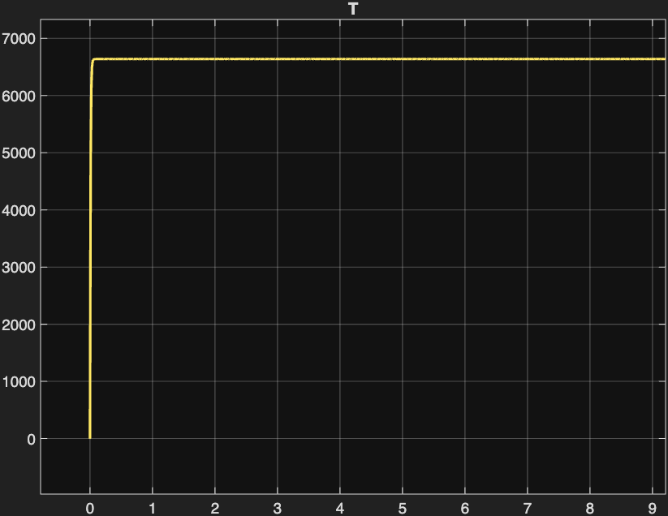
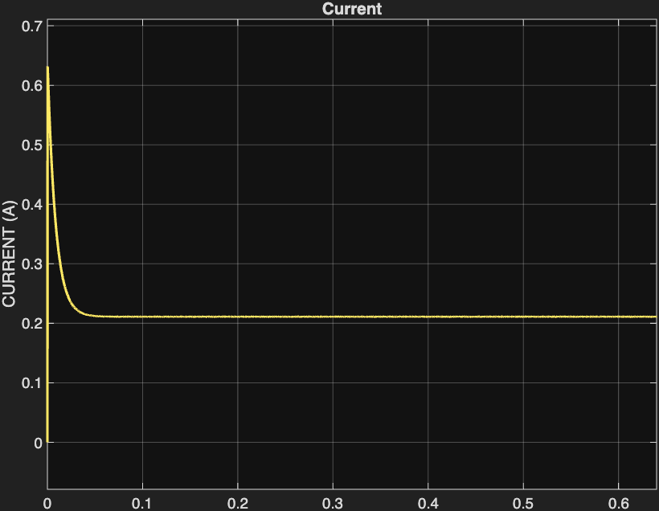
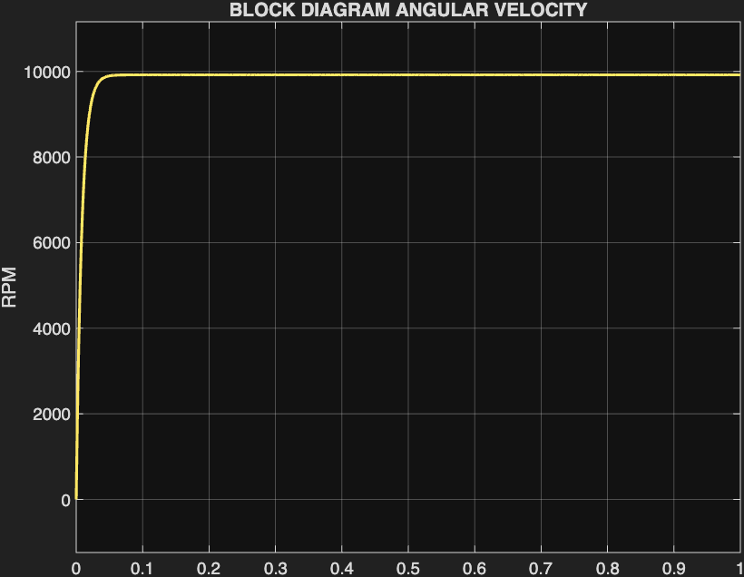
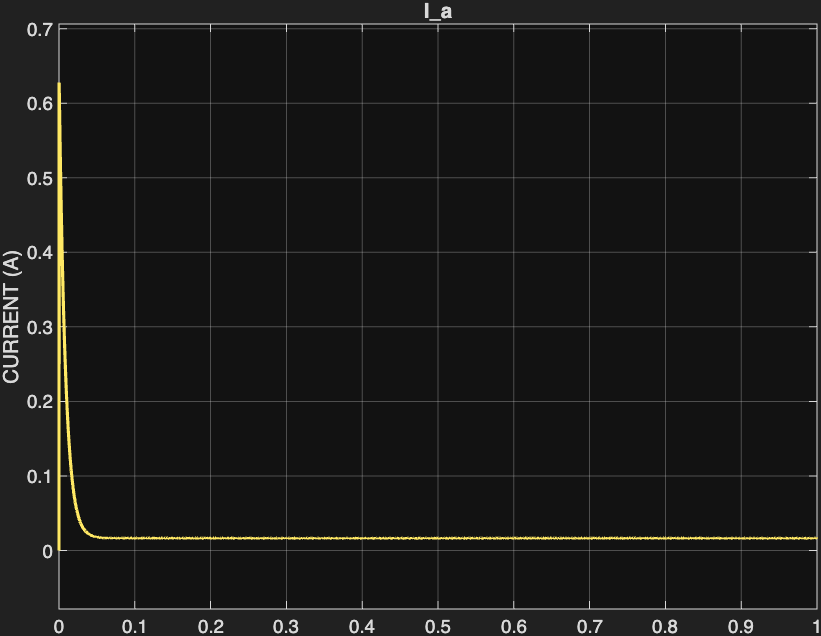
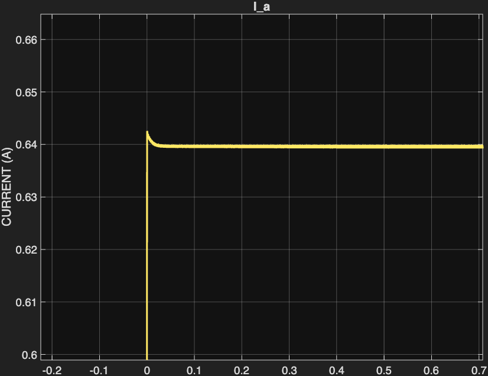
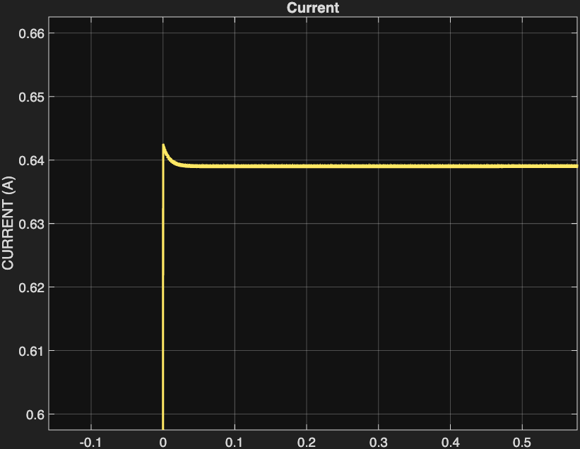

# 🦎 The Lizard: Maxon DC Motor Modeling, Parameter Identification & Multi-Domain Simulation

[](https://www.mathworks.com/)
[-blue.svg?style=flat-square)](https://www.maxongroup.com/)
[](#)
[](LICENSE)
[](https://github.com/sbbxiii)

---

## 1. Executive Summary

**The Lizard** is a first-principles electro-mechanical model, analytical transfer function derivation, parameter identification, and multi-domain simulation suite for the **Maxon DC-max 16 S (24V)** graphite-brushed DC motor.

The motor dynamics are implemented and cross-validated across **three independent simulation paradigms** in MATLAB & Simulink:
1. **Analytical Transfer Function Model (`SYS1`, `SYS2`, `SYS3` via Model Linearizer)**: Evaluated in the frequency and Laplace $s$-domains.
2. **Differential Equation Block Diagram Model**: Direct state-variable integration of Kirchhoff’s Voltage Law (KVL) and Newton’s second rotational law.
3. **Simscape Multi-Domain Physical Network**: A physics-based causal network modeling real-world electrical (current/voltage sensors, reference grounds) and mechanical (rotor inertia, damping, torque loading) domains.

All three implementations are benchmarked against official manufacturer specifications ([`Cataloge-Page-EN-122.pdf`](docs/Maxon_DC_max_16S_Catalog.pdf)) across **No-Load**, **Nominal Load**, and **Stall** regimes, achieving $<1\%$ steady-state tracking error.

---

## 2. Simulation Architectures

### Simulink Differential Equation Block Diagram

*Figure 1: Closed-loop electro-mechanical block diagram with armature back-EMF feedback, torque constant gain $k_\phi$, and mechanical damping.*

### Simscape Physical Multi-Domain Network

*Figure 2: Simscape physical schematic showing coupled electrical domain (blue) and rotational mechanical domain (green) with physical-signal sensors.*

---

## 3. Mathematical Formulation & Derivations

### Governing Time-Domain Differential Equations

The dynamic behavior of a permanent magnet DC motor is governed by coupled electrical and rotational mechanical equations:

1. **Electrical Subsystem (Kirchhoff's Voltage Law):**
   $$V_a(t) = R_a i_a(t) + L_a \frac{di_a(t)}{dt} + e_b(t)$$
   where the counter-electromotive force (back-EMF) is proportional to rotational velocity:
   $$e_b(t) = k_\phi \omega_m(t)$$

2. **Mechanical Subsystem (Newton's Second Law for Rotation):**
   $$J_m \frac{d\omega_m(t)}{dt} = T_m(t) - B_m \omega_m(t) - T_L(t)$$
   where the generated electromagnetic torque is proportional to armature current:
   $$T_m(t) = k_\phi i_a(t)$$

---

### Laplace S-Domain Transfer Functions

Assuming zero initial conditions and no external load torque ($T_L = 0$):

$$\begin{aligned}
V_a(s) &= (L_a s + R_a) I_a(s) + k_\phi \Omega_m(s) \\
k_\phi I_a(s) &= (J_m s + B_m) \Omega_m(s)
\end{aligned}$$

#### 1. Angular Velocity Transfer Function $\frac{\Omega_m(s)}{V_a(s)}$:
$$\frac{\Omega_m(s)}{V_a(s)} = \frac{k_\phi}{J_m L_a s^2 + (J_m R_a + B_m L_a) s + (R_a B_m + k_\phi^2)}$$

#### 2. Armature Current Transfer Function $\frac{I_a(s)}{V_a(s)}$:
$$\frac{I_a(s)}{V_a(s)} = \frac{J_m s + B_m}{J_m L_a s^2 + (J_m R_a + B_m L_a) s + (R_a B_m + k_\phi^2)}$$

---

## 4. Parameter Identification (Maxon DC-max 16 S)

Extracted from the official Maxon catalog datasheet:

| Parameter | Symbol | Catalog Value | Units | Description / Derivation |
| :--- | :---: | :---: | :---: | :--- |
| **Nominal Voltage** | $V_{an}$ | $24.0$ | $\text{V}$ | Rated input armature voltage |
| **Terminal Resistance** | $R_a$ | $37.5$ | $\Omega$ | Phase winding resistance |
| **Terminal Inductance** | $L_a$ | $1.37 \times 10^{-3}$ | $\text{H}$ | Armature winding inductance |
| **Torque / Speed Constant** | $k_\phi$ | $0.0225$ | $\text{N}\cdot\text{m/A}$ ($\text{V}\cdot\text{s/rad}$) | Flux linkage constant |
| **Rotor Inertia** | $J_m$ | $1.16 \times 10^{-7}$ | $\text{kg}\cdot\text{m}^2$ | Mass moment of inertia of rotor |
| **No-Load Current** | $I_{anl}$ | $0.0168$ | $\text{A}$ | Idling current draw ($16.8\text{ mA}$) |
| **Nominal Torque** | $T_n$ | $4.76 \times 10^{-3}$ | $\text{N}\cdot\text{m}$ | Continuous operating load ($4.76\text{ mN}\cdot\text{m}$) |
| **Stall Torque** | $T_s$ | $14.4 \times 10^{-3}$ | $\text{N}\cdot\text{m}$ | Peak stall torque ($14.4\text{ mN}\cdot\text{m}$) |
| **Viscous Friction Coeff.** | $B_m$ | $3.64 \times 10^{-7}$ | $\text{N}\cdot\text{m}\cdot\text{s/rad}$ | **Identified via steady-state no-load equation:** $B_m = \frac{k_\phi^2 I_{anl}}{V_{an} - R_a I_{anl}}$ |

### Time Constant Evaluation
* **Electrical Time Constant ($\tau_e$):**
  $$\tau_e = \frac{L_a}{R_a} = \frac{1.37 \times 10^{-3}\text{ H}}{37.5\ \Omega} = 36.5\ \mu\text{s}$$
* **Mechanical Time Constant ($\tau_m$):**
  $$\tau_m = \frac{R_a J_m}{k_\phi^2} = \frac{(37.5)(1.16 \times 10^{-7})}{(0.0225)^2} = 8.59\text{ ms}$$
Because $\tau_m \gg \tau_e$ (ratio $> 235:1$), mechanical inertia dominates the system bandwidth.

---

## 5. Verification Benchmark: Datasheet vs. Simulation

| Performance Metric | Datasheet Value | Simulink Block Diagram | Simscape Physical Model | Steady-State Error |
| :--- | :---: | :---: | :---: | :---: |
| **No-Load Speed (ω_nl)** | 9,920 RPM | 9,919 RPM | 9,909 RPM | **&lt; 0.11%** |
| **No-Load Current (I_nl)** | 16.8 mA | 16.4 mA | 16.77 mA | **&lt; 0.20%** |
| **Nominal Speed (ω_n)** | 6,580 RPM | 6,640 RPM | 6,637 RPM | **&lt; 0.91%** |
| **Nominal Current (I_n)** | 0.227 A | 0.2227 A | 0.2226 A | **&lt; 1.90%** |
| **Stall Current (I_s)** | 0.640 A | 0.6398 A | 0.6394 A | **&lt; 0.09%** |

---

## 6. Dynamic Transient Response Gallery

### Nominal Load Regime (Continuous Rated Operation)
| Angular Velocity Step Response (6,640 RPM) | Armature Current Transient Response (0.22 A) |
| :---: | :---: |
|  |  |

### No-Load Regime (Unloaded Idling)
| No-Load Velocity Steady-State (9,919 RPM) | No-Load Current Idling (16.4 mA) |
| :---: | :---: |
|  |  |

### Stall Condition Comparison (Peak Torque & Current)
| Differential Equation Block Diagram Stall Current | Simscape Physical Network Stall Current |
| :---: | :---: |
|  |  |

---

## 7. Thermal Analysis & Safe Ambient Limits

Under continuous nominal load operation ($T_n = 4.76\text{ mN}\cdot\text{m}$, $I_n = 0.227\text{ A}$):
1. **Winding Joule Losses:**
   $$P_{\text{loss}} = I_n^2 R_a = (0.227\text{ A})^2 \times 37.5\ \Omega = 1.93\text{ W}$$
2. **Thermal Temperature Rise:**
   Given the thermal resistance winding-to-housing $R_{th1} = 9.1\text{ K/W}$ and housing-to-ambient $R_{th2} = 35.0\text{ K/W}$ (total $R_{th} = 44.1\text{ K/W}$):
   $$\Delta T = P_{\text{loss}} \times R_{th} = 1.93\text{ W} \times 44.1\text{ K/W} \approx 85.1^\circ\text{C}$$
3. **Maximum Safe Ambient Operating Temperature:**
   For a maximum rated winding temperature $T_{\text{max}} = 125^\circ\text{C}$:
   $$T_{\text{amb, max}} = T_{\text{max}} - \Delta T = 125^\circ\text{C} - 85.1^\circ\text{C} \approx 39.9^\circ\text{C}$$

---

## 8. How to Run the Simulation

### Prerequisites
* **MATLAB** (R2022b or later recommended)
* **Simulink**
* **Simscape / Simscape Driveline / Simscape Electrical**
* **Control System Toolbox**

### Execution Steps
1. Clone this repository:
   ```bash
   git clone https://github.com/sbbxiii/The-Lizard.git
   cd The-Lizard
   ```
2. Open MATLAB and navigate to the `simulation/` directory.
3. Run [`simulation/mainEMD.m`](simulation/mainEMD.m):
   ```matlab
   run('mainEMD.m')
   ```
   * Computes motor parameters and stores variables in the base workspace.
   * Derives closed-loop transfer functions `SYS1`, `SYS2`, and `SYS3`.
   * Solves partial fraction residue decomposition for the $24\text{V}$ unit step input.
4. Open the Simulink model [`simulation/mainEMDmode.slx`](simulation/mainEMDmode.slx):
   ```matlab
   open_system('mainEMDmode.slx')
   ```
5. Click **Run** to execute the multi-domain simulation and observe the transient curves on the Scopes.

---

## 9. Repository Structure

```
The-Lizard/
├── simulation/
│   ├── mainEMD.m                       # Core MATLAB parameter script & TF derivation
│   ├── mainEMDmode.slx                 # Simulink & Simscape multi-paradigm model
│   ├── emdlin.mat                      # Linearized state-space model object
│   └── matlab.mat                      # Saved workspace variable state
├── docs/
│   ├── DC_Motor_Simulation_Report.pdf  # Comprehensive academic technical report
│   ├── Maxon_DC_max_16S_Catalog.pdf    # Official Maxon manufacturer datasheet
│   └── images/                         # Simulation diagrams & transient response plots
│       ├── simulink_block_diagram.png
│       ├── simscape_physical_model.png
│       ├── nominal_speed_response.png
│       ├── nominal_current_response.png
│       ├── no_load_speed_response.png
│       ├── no_load_current_response.png
│       ├── stall_current_block_diagram.png
│       └── stall_current_simscape.png
├── .gitignore
├── LICENSE
└── README.md
```

---

## 10. Author & License

* **Engineered by:** Osakwe Nmesoma Chukwukadibia ([@sbbxiii](https://github.com/sbbxiii))
* **License:** [MIT License](LICENSE)
